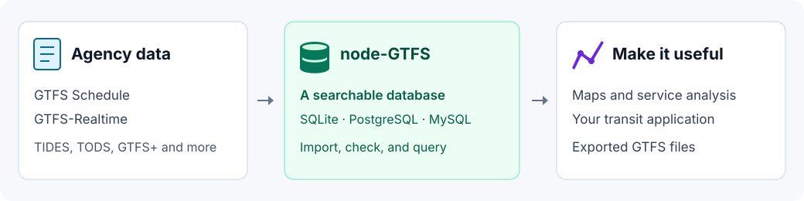

# node-GTFS

<p align="center">
  
</p>

[](https://www.npmjs.com/package/gtfs)
[](https://www.npmjs.com/package/gtfs)
[](package.json)
[](https://github.com/BlinkTagInc/node-gtfs/actions/workflows/nodejs.yml)
[](LICENSE.md)

Turn a transit agency’s GTFS data into something you can explore and use.

**node-GTFS imports transit schedules into a database**, then helps you find
routes, stops, trips, and arrival times. You can use it to prepare data for a
map, analyze service, build a transit application, or export GTFS files.
It also stores GTFS-Realtime updates, including service alerts and vehicle
positions.

GTFS is the format transit agencies use to share their service information.
A static GTFS feed is usually a ZIP containing files such as `routes.txt` and
`stops.txt`. node-GTFS reads those files and makes their contents searchable.



## What would you like to do?

| I want to…                               | Start here                                     |
| ---------------------------------------- | ---------------------------------------------- |
| Load an agency’s GTFS for the first time | [Getting started](docs/getting-started.md)     |
| Run imports and exports from a terminal  | [Command line](docs/cli.md)                    |
| Upgrade an application from v4           | [Migration guide](docs/migrating-to-v5.md)     |
| Use PostgreSQL or MySQL                  | [Database setup](docs/databases.md)            |
| Find routes, stops, trips, or arrivals   | [Query data](docs/queries.md)                  |
| Count trips or summarize service         | [Summaries and aggregates](docs/aggregates.md) |
| Put stops and routes on a map            | [GeoJSON](docs/geojson.md)                     |
| Store live alerts or vehicle updates     | [GTFS-Realtime](docs/realtime.md)              |
| Import updated schedules automatically   | [Import data](docs/import.md)                  |
| Get GTFS files back out of a database    | [Export data](docs/export.md)                  |

**[Browse all documentation](docs/README.md)** for configuration, validation,
advanced queries, field references, and troubleshooting.

## Why node-GTFS?

- Read GTFS Schedule and GTFS-Realtime, with optional extensions like TIDES and TODS.
- Start with a local SQLite file, or use PostgreSQL or MySQL.
- Keep several static GTFS feeds together without changing their GTFS identifiers.
- Optionally validate static GTFS feeds during import and get messages that identify data problems.
- Query GTFS and GTFS-Realtime from JavaScript or TypeScript.
- Create GeoJSON and export schedule data from any supported database.
- Use terminal commands for import/export, or the JavaScript API in an application.

## Is this the right tool?

Use node-GTFS when you have GTFS data and want to query, transform, or serve it
from your own workflow. The command line is useful even if you do not write
JavaScript; custom analysis and applications need some programming or SQL.

It is not a point-and-click timetable editor, a hosted transit-data service,
or a journey-planning engine (although you could build these things with node-GTFS). It does not display a map on its own or calculate
the best journey between two places. Static GTFS feed validation helps with imports; it
is not a certification that a static GTFS feed meets every rule in its specification.

## Get started

Node-GTFS supports Node.js 22.18+ (22.x), 24, or 26+.
Install [Node.js](https://nodejs.org/), then try importing
[Caltrain’s public static GTFS feed](https://www.caltrain.com/developer-resources) - no
account or API key is needed. In your terminal, run:

```sh
npm install --global gtfs
gtfs import \
  --url https://data.trilliumtransit.com/gtfs/caltrain-ca-us/caltrain-ca-us.zip \
  --source-id caltrain \
  --database ./caltrain.sqlite
```

This downloads Caltrain’s schedules and creates `caltrain.sqlite` in your current
folder. You do not need to install a database server. Run the import again to
replace Caltrain’s stored Schedule data with the latest static GTFS feed.

Static GTFS feed validation is off by default; see [how to enable it](docs/validation.md).
This static GTFS feed also includes optional extensions, so you may see notices about
files that were not imported. Once the import completes, its Schedule data
is ready to query.

Already have a GTFS ZIP? Import it into a separate database instead:

```sh
gtfs import --input ./feed.zip --database ./transit.sqlite
```

To explore the Caltrain database from JavaScript, run `npm install gtfs` in your
project folder and save this as `routes.mjs` beside `caltrain.sqlite`:

```js
import { Gtfs } from 'gtfs';

const gtfs = new Gtfs({
  database: { path: './caltrain.sqlite' },
});

try {
  const routes = await gtfs.schedule.routes
    .select('route_id', 'route_short_name', 'route_long_name')
    .orderBy([{ field: 'route_id', direction: 'asc' }])
    .all();

  console.table(routes);
} finally {
  await gtfs.close();
}
```

Run `node routes.mjs` to see the route names. To query your own static GTFS feed instead,
change the database path to `./transit.sqlite`.

## Next steps

- [Follow the step-by-step guide](docs/getting-started.md) with your own static GTFS feed.
- [Choose a sample configuration](docs/configuration.md#sample-configuration-files)
  to save settings for Schedule, GTFS-Realtime, or multiple static GTFS feeds.
- [Find trips and arrivals](docs/queries.md#query-service-routes-and-stops).
- [Enable static GTFS feed validation](docs/validation.md) and [interpret warnings](docs/reporting.md).
- [Browse every guide and field reference](docs/README.md).

## Built with node-GTFS

Explore these projects for ready-to-use transit tools and ideas for your own
applications. Project names link to their source code and setup instructions.

| Project                                                                                     | What you can do with it                                                                   | Maintained? |
| ------------------------------------------------------------------------------------------- | ----------------------------------------------------------------------------------------- | ----------- |
| [GTFS-to-HTML](https://github.com/BlinkTagInc/gtfs-to-html)                                 | Turn GTFS into accessible HTML timetables, printable PDFs, CSV schedules, and route maps. | Yes         |
| [GTFS-to-GeoJSON](https://github.com/BlinkTagInc/gtfs-to-geojson)                           | Export stops and route shapes as GeoJSON for transit maps.                                | Yes         |
| [GTFS-to-Chart](https://github.com/BlinkTagInc/gtfs-to-chart)                               | Visualize scheduled vehicle movements through the day with stringline charts.             | Yes         |
| [GTFS Accessibility Validator](https://github.com/BlinkTagInc/gtfs-accessibility-validator) | Check accessibility fields, station pathways and levels, and route-color contrast.        | Yes         |
| [GTFS Text-to-Speech](https://github.com/BlinkTagInc/gtfs-tts)                              | Listen to stop names and identify pronunciations that need a `tts_stop_name` value.       | Yes         |
| [Transit Departures Widget](https://github.com/BlinkTagInc/transit-departures-widget)       | Add a stop-by-stop departure lookup to a website using Schedule and GTFS-Realtime data.   | Yes         |
| [GTFS-to-Blocks](https://github.com/BlinkTagInc/gtfs-to-blocks)                             | Export trips grouped by vehicle block to review overlaps and gaps in the schedule.        | Yes         |

Built something with node-GTFS? Open a pull request to add your project with
a source link, a short description, and its maintenance status. An
[issue](https://github.com/BlinkTagInc/node-gtfs/issues) introducing your project
is welcome too.

## Help and contributions

Start with [troubleshooting](docs/troubleshooting.md) for common problems and
the [changelog](CHANGELOG.md) for release notes and breaking changes.

Questions and problem reports are welcome in
[GitHub issues](https://github.com/BlinkTagInc/node-gtfs/issues) - you do not need
to submit code. When possible, include a link to the specific GTFS
and the error you encountered.

Pull requests are welcome too - see the
[contribution guide](https://github.com/BlinkTagInc/node-gtfs/blob/main/CONTRIBUTING.md).
Thank you to everyone who has contributed fixes, ideas, and static GTFS feed examples:
[see the contributors](https://github.com/BlinkTagInc/node-gtfs/graphs/contributors).

Maintained by [BlinkTag Inc.](https://blinktag.com/). Released under the
[MIT license](LICENSE.md). See the
[security policy](https://github.com/BlinkTagInc/node-gtfs/blob/main/SECURITY.md) to report a
security concern and [CITATION.cff](CITATION.cff) for citation information if you use node-gtfs in research.
